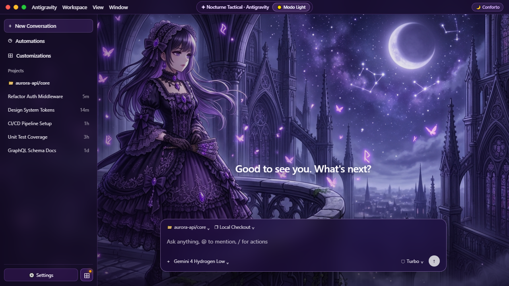
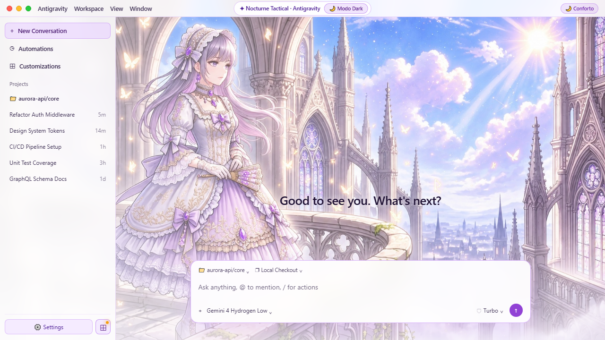
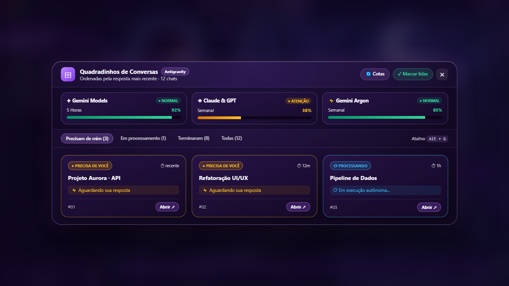
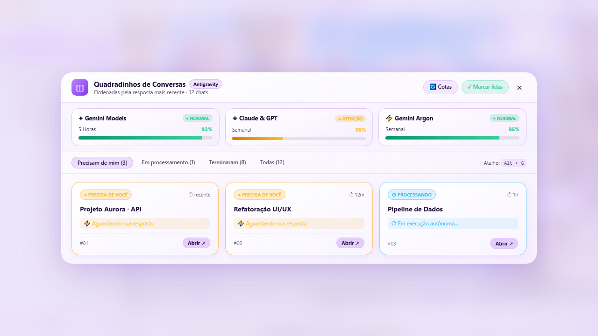

# ◆ Antigravity Anime Theme (Dark & Light Mode)

[](LICENSE)
[](#)
[](#)

A sleek **Frosted Glassmorphism & Anime Theme** for **Antigravity**, featuring an instant **Dark / Light Mode** toggle, macOS-style window controls, an eye-comfort night filter, and a tactical **Conversation Grid HUD** (`Alt + G`) with real-time model quota tracking.

---

## 🎨 Visual Previews (Dark & Light Mode)

### 🌙 Dark Mode — *Nocturne Tactical*


### ☀️ Light Mode — *Aurora Celestial*


---

## 💬 New Conversation Flow

| Dark Mode Start Screen | Light Mode Start Screen |
| :---: | :---: |
|  |  |

---

## ⊞ Tactical Conversation Grid HUD (`Alt + G`)

Manage all your active, pending, and completed conversations in a clean glassmorphic grid overlay:
- **Real-Time Quota HUD**: Track remaining 5-hour and weekly quotas for Gemini, Claude & GPT, and Argon models.
- **Smart Filters**: *Needs Me*, *Processing*, *Finished*, and *All*.
- **Contextual Status Cards**: Pulsating status beacons, relative timestamps, and smooth hover micro-interactions.

| Dark Mode HUD | Light Mode HUD |
| :---: | :---: |
|  |  |

---

## ✦ Key Features

- **Instant Dark / Light Mode Switcher**: Dedicated toggle pill right next to the `✦ Nocturne Tactical · Antigravity` badge in the title bar (or press `Alt + L`). Your preference is automatically persisted in `localStorage`.
- **Eye-Comfort Night Filter (`Alt + N`)**: Warm sepia/dimming overlay designed to reduce eye strain during late-night coding sessions.
- **Conversation Grid HUD (`Alt + G`)**: Quick-jump grid modal accessible via keyboard shortcut or the `⊞` button next to *Settings*.
- **Custom Dual-Mode Wallpapers**:
  - Dark Mode: [nocturne_dark_bg.jpg](assets/nocturne_dark_bg.jpg)
  - Light Mode: [nocturne_light_bg.jpg](assets/nocturne_light_bg.jpg)

---

## 🚀 Quick Installation (Windows)

1. Clone this repository:
   ```bash
   git clone https://github.com/pietroxvier/antigravity-anime-theme.git
   cd antigravity-anime-theme
   ```
2. Run the Python installer (automatically creates an `app.asar.bak` backup before patching):
   ```bash
   python install.py
   ```
3. Press **`Ctrl + R`** inside Antigravity (or restart the app) to apply.

### Uninstall / Restore Original
```bash
python install.py --uninstall
```

---

## ⌨️ Keyboard Shortcuts

| Shortcut | Action |
| :--- | :--- |
| **`Alt + L`** | Toggle between **Dark Mode** and **Light Mode** |
| **`Alt + G`** | Open / close the **Conversation Grid HUD** |
| **`Alt + N`** | Toggle **Eye-Comfort Night Filter** |
| **`Esc`** | Close active modal |

---

## 📄 License

Distributed under the MIT License. See [LICENSE](LICENSE) for more information.
