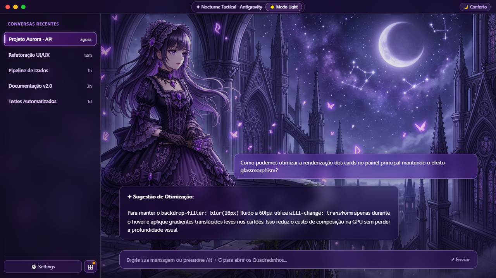
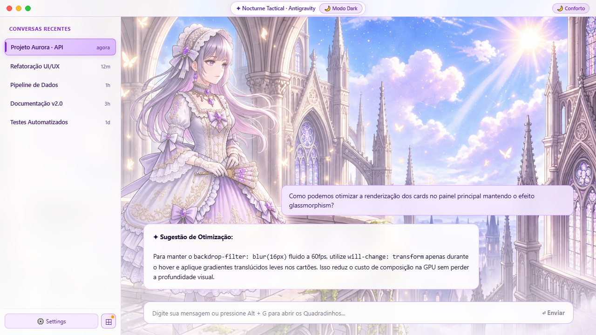

# ✦ Nocturne Tactical · Antigravity Skin (Dark & Light Mode)

Uma skin completa com **Glassmorphism**, alternância instantânea entre **Modo Dark (Nocturne)** e **Modo Light (Aurora Celestial)**, barra superior estilo macOS e o painel tático **Quadradinhos de Conversas** para o **Antigravity**.

---

## 🎨 Previews (Dark vs Light)

### 🌙 Modo Dark (Nocturne Tactical)


### ☀️ Modo Light (Aurora Celestial)


---

## ⊞ Quadradinhos de Conversas (`Alt + G`)

Painel centralizado com:
- **Cotas em tempo real** (Gemini, Claude & GPT, Gemini Argon) com barras de progresso e tempo de renovação.
- **Filtros inteligentes**: *Precisam de mim*, *Em processamento*, *Terminaram* e *Todas*.
- **Cards contextuais** com badges pulsantes, status de execução e microinterações no hover.

| Modo Dark | Modo Light |
| :---: | :---: |
|  |  |

---

## ✨ Recursos Principais

- **Alternância Dark / Light Instantânea**: Botão dedicado ao lado do badge `✦ Nocturne Tactical · Antigravity` na barra superior (ou atalho `Alt + L`). Preferência salva automaticamente em `localStorage`.
- **Modo Conforto Visual (`Alt + N`)**: Filtro quente noturno para reduzir fadiga ocular durante longas sessões.
- **Quadradinhos de Conversas (`Alt + G`)**: Visão em grade de todos os chats ativos, pendentes e concluídos, acessível pelo botão `⊞` ao lado de *Settings*.
- **Planos de Fundo Exclusivos**:
  - Dark Mode: [nocturne_dark_bg.jpg](assets/nocturne_dark_bg.jpg)
  - Light Mode: [nocturne_light_bg.jpg](assets/nocturne_light_bg.jpg)

---

## 🚀 Instalação (Windows)

1. Clone este repositório:
   ```bash
   git clone https://github.com/pietroxvier/nocturne-tactical-antigravity.git
   cd nocturne-tactical-antigravity
   ```
2. Execute o instalador Python (ele cria um backup automático `app.asar.bak` antes de aplicar):
   ```bash
   python install.py
   ```
3. No Antigravity, pressione **`Ctrl + R`** (ou reinicie o aplicativo).

### Desinstalar / Restaurar Original
```bash
python install.py --uninstall
```

---

## ⌨️ Atalhos de Teclado

| Atalho | Ação |
| :--- | :--- |
| **`Alt + L`** | Alterna entre **Modo Dark** e **Modo Light** |
| **`Alt + G`** | Abre / fecha o modal **Quadradinhos de Conversas** |
| **`Alt + N`** | Ativa / desativa o **Modo Conforto Visual** |
| **`Esc`** | Fecha o modal aberto |

---

## 📄 Licença

Distribuído sob a licença MIT. Veja [LICENSE](LICENSE) para mais detalhes.
